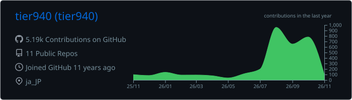
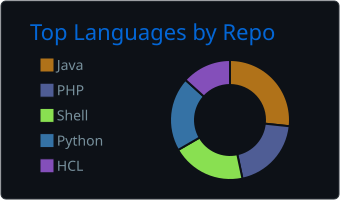
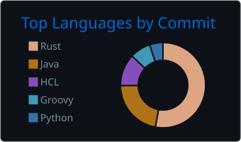
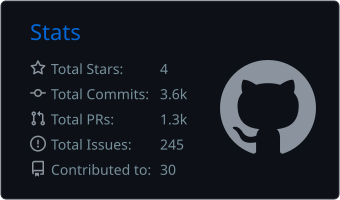
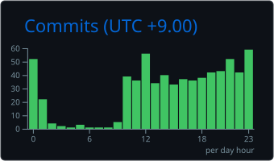
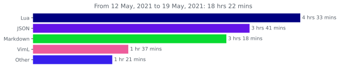
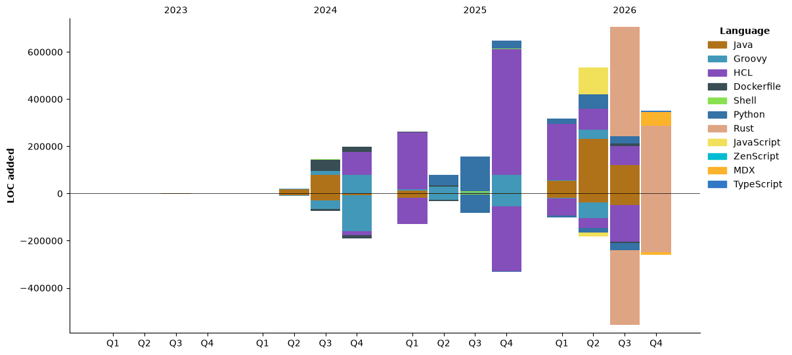

### 👋 Hi! I'm tier940

<p align="left"> 
  <a href="https://github.com/tier940/tier940/">
    
  </a>
  <a href="http://twitter.com/tier940">
    
  </a>
  <a href="https://github.com/tier940">
    
  </a>
  <a href="https://www.reddit.com/user/tier940">
    
  </a>
  <a href="https://stackoverflow.com/users/17317833/tier940">
    
  </a>
  <a href="https://zenn.dev/tier940">
    
  </a>
  <a href="https://zenn.dev/tier940">
    
  </a>
  <a href="https://zenn.dev/tier940">
    
  </a>
  <a href="http://qiita.com/tier940">
    
  </a>
  <a href="http://qiita.com/tier940">
    
  </a>
  <a href="https://github.com/tier940/tier940/">
    
  </a>
  <a href="https://keybase.io/tier940">
    
  </a>
  <a href="https://keybase.io/tier940">
    
  </a>
</p>

[](https://github.com/vn7n24fzkq/github-profile-summary-cards)
[](https://github.com/vn7n24fzkq/github-profile-summary-cards) [](https://github.com/vn7n24fzkq/github-profile-summary-cards)
[](https://github.com/vn7n24fzkq/github-profile-summary-cards) [](https://github.com/vn7n24fzkq/github-profile-summary-cards)


#### Analysis
<!--  -->

<details>
  <summary>Other Statics</summary>
  <!--START_SECTION:waka-->


**🐱 My GitHub Data** 

> 📦 90.0 kB Used in GitHub's Storage 
 > 
> 💼 Opted to Hire
 > 
> 📜 15 Public Repositories 
 > 
> 🔑 9 Private Repositories 
 > 
**I'm a Night 🦉** 

```text
🌞 Morning                1792 commits        ████░░░░░░░░░░░░░░░░░░░░░   15.83 % 
🌆 Daytime                3744 commits        ████████░░░░░░░░░░░░░░░░░   33.08 % 
🌃 Evening                4286 commits        █████████░░░░░░░░░░░░░░░░   37.87 % 
🌙 Night                  1496 commits        ███░░░░░░░░░░░░░░░░░░░░░░   13.22 % 
```
📅 **I'm Most Productive on Saturday** 

```text
Monday                   1338 commits        ███░░░░░░░░░░░░░░░░░░░░░░   11.82 % 
Tuesday                  1610 commits        ████░░░░░░░░░░░░░░░░░░░░░   14.23 % 
Wednesday                1291 commits        ███░░░░░░░░░░░░░░░░░░░░░░   11.41 % 
Thursday                 1525 commits        ███░░░░░░░░░░░░░░░░░░░░░░   13.47 % 
Friday                   1395 commits        ███░░░░░░░░░░░░░░░░░░░░░░   12.33 % 
Saturday                 2165 commits        █████░░░░░░░░░░░░░░░░░░░░   19.13 % 
Sunday                   1994 commits        ████░░░░░░░░░░░░░░░░░░░░░   17.62 % 
```


📊 **This Week I Spent My Time On** 

```text
🕑︎ Time Zone: Asia/Tokyo

💬 Programming Languages: 
Other                    81 hrs 42 mins      ██████████████████░░░░░░░   73.01 % 
Markdown                 10 hrs 20 mins      ██░░░░░░░░░░░░░░░░░░░░░░░   09.24 % 
Rust                     5 hrs 23 mins       █░░░░░░░░░░░░░░░░░░░░░░░░   04.82 % 
JavaScript               5 hrs 19 mins       █░░░░░░░░░░░░░░░░░░░░░░░░   04.76 % 
TypeScript               2 hrs 1 min         ░░░░░░░░░░░░░░░░░░░░░░░░░   01.81 % 

🔥 Editors: 
Chrome                   44 hrs 40 mins      ██████████░░░░░░░░░░░░░░░   39.93 % 
Opencode Cli             37 hrs 9 mins       ████████░░░░░░░░░░░░░░░░░   33.21 % 
VS Code                  27 hrs 28 mins      ██████░░░░░░░░░░░░░░░░░░░   24.56 % 
OpenCode                 2 hrs 34 mins       █░░░░░░░░░░░░░░░░░░░░░░░░   02.30 % 
Claude Code              0 secs              ░░░░░░░░░░░░░░░░░░░░░░░░░   00.01 % 

💻 Operating System: 
Linux                    89 hrs 35 mins      ████████████████████░░░░░   80.05 % 
Windows                  22 hrs 19 mins      █████░░░░░░░░░░░░░░░░░░░░   19.95 % 
```

🤖 **AI Coding This Week** 

```text
⏱ AI Coding Time: 66 hrs 54 mins (59.78%)

✍️ 9,209 lines written by AI, 46 lines written by hand (99.5% AI-written)

🔤 28,764,878 Input Tokens, 2,559,437 Output Tokens

💵 $213.30 Estimated AI Cost This Week

🧠 42 AI Sessions, 658 AI Prompts

Sonnet                   7,566 lines         ████████████████████░░░░░   81.98 % 
Qwen                     1,246 lines         ███░░░░░░░░░░░░░░░░░░░░░░   13.50 % 
Haiku                    417 lines           █░░░░░░░░░░░░░░░░░░░░░░░░   04.52 % 
GPT                      0 lines             ░░░░░░░░░░░░░░░░░░░░░░░░░   00.00 % 
Opus                     0 lines             ░░░░░░░░░░░░░░░░░░░░░░░░░   00.00 % 

🔎 AI Coding Insights:
🤖 AI-Driven — 99.5% of written lines came from AI
📄 Detailed Prompter — average 591 characters per prompt
🔁 Iterative Prompter — average 16 prompts per session
🚀 High AI Trust — 0.99% of changed lines were hand-edited
```

**I Mostly Code in Java** 

```text
Java                     17 repos            ██████████░░░░░░░░░░░░░░░   41.46 % 
Python                   4 repos             ██░░░░░░░░░░░░░░░░░░░░░░░   09.76 % 
Shell                    3 repos             ██░░░░░░░░░░░░░░░░░░░░░░░   07.32 % 
HCL                      3 repos             ██░░░░░░░░░░░░░░░░░░░░░░░   07.32 % 
JavaScript               1 repo              █░░░░░░░░░░░░░░░░░░░░░░░░   02.44 % 
```


**Timeline**




 Last Updated on 01/11/2026 03:15:40 UTC
<!--END_SECTION:waka-->
</details>
